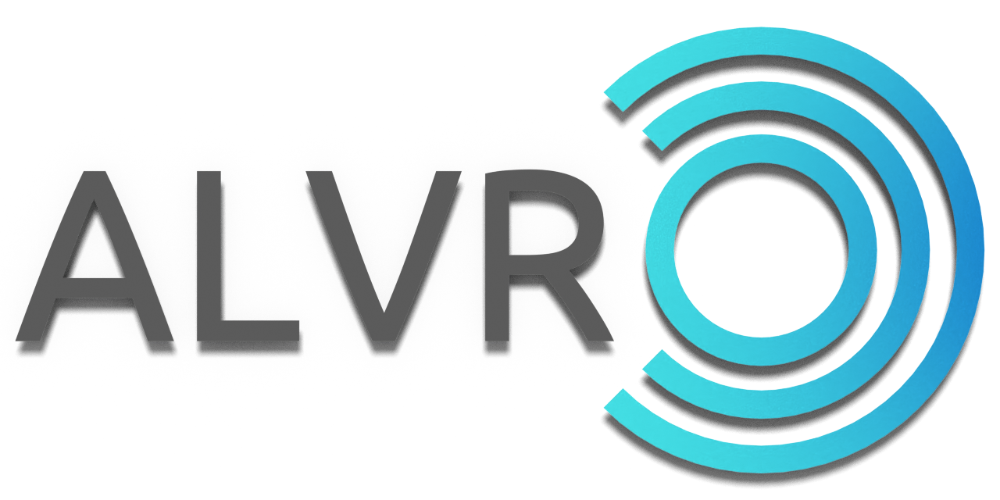

<p align="center">  </p>

# ALVR-Go

A fork of [ALVR](https://github.com/alvr-org/ALVR) 18.2.3 aimed only at the **Oculus Go**: stream SteamVR games from your PC to the headset over Wi-Fi.

ALVR uses technologies like [Asynchronous Timewarp](https://developer.oculus.com/documentation/native/android/mobile-timewarp-overview) and [Fixed Foveated Rendering](https://developer.oculus.com/documentation/native/android/mobile-ffr) for a smoother experience. All games that work with an Oculus Rift (s) should work with ALVR.

> **Status:** the fork builds, but it has been tested on a limited setup (Windows server with an AMD GPU). There are no pre-built releases yet, so you have to [build it from source](#build-from-source). Quest and Quest 2 are not supported by this fork.

## What is different from upstream ALVR 18.2.3

-   **Go-only defaults**: 60 Hz, H.264, 25 Mbit/s starting bitrate (adaptive, capped at 50 Mbit/s). Settings that only make sense for other headsets (device emulation, hand tracking, Vive trackers, haptics tuning, 10-bit encoding...) and the presets were removed.
-   **Oculus Go controller mapped to an Oculus Touch layout** (see [below](#oculus-go-controller)).
-   **Native egui desktop UI**: the launcher and the dashboard are native windows. The web dashboard, the embedded Chromium and the GTK/Druid launcher were removed, so no browser is needed.
-   **No update system**: no update check, no installer download. New versions are installed manually.
-   **A more robust stream**: adaptive bitrate re-evaluated every 250 ms, explicit CBR on AMD AMF (with fallback to plainer AMF usages for older cards such as the RX 550), spatial AQ on NVENC, bigger UDP socket buffers, a Wi-Fi high-performance lock on the headset and a cached FEC codec.
-   **The connection survives the Oculus menu**: pausing the app no longer drops the stream or shows the pairing screen again, and waking the Go no longer ends in a black screen.
-   **Fixed game audio capture** with current CPAL versions.
-   **Updated toolchain**: every Rust dependency, Gradle 9 / AGP 9, NDK 27 and JDK 21.

The wire protocol is unchanged, so the client and server of this fork are meant to be used together. See [docs/](docs/README.md) for the architecture, requirements and the fork direction.

## Requirements

-   Oculus Go on the latest firmware  

-   SteamVR  

-   A gaming PC with Windows 10 or newer (Linux server code is inherited from upstream but has not been tested in this fork)
    -   NVIDIA GPU that supports NVENC, or an AMD GPU that supports AMF VCE, with the latest driver.  
    -   Laptops with an onboard (Intel HD, AMD iGPU) and an additional dedicated GPU: assign the dedicated GPU or "high performance graphics adapter" to ALVR and SteamVR for best performance and compatibility.

-   802.11ac 5Ghz wireless on the headset and, ideally, ethernet on the PC  
    -   Both devices must be on the same router (or use a routed connection as described [here](https://github.com/alvr-org/ALVR/wiki/ALVR-client-and-server-on-separate-networks))

## Install

There are no pre-built releases yet. Build the server and the client as described in [Build from source](#build-from-source), then:

1.  Install the APK on the Go (`adb install -r <apk>`; the Go needs developer mode enabled).
2.  Run `ALVR Launcher.exe` on the PC. It registers the driver, starts SteamVR and opens the dashboard.
3.  Start ALVR on the headset and add it as a client in the dashboard.

## Oculus Go controller

The Go controller only has a trigger, a clickable trackpad and a back button (its home button belongs to the headset and is never sent to the PC), so the client maps it to an Oculus Touch controller and emulates the missing buttons with the trackpad edges:

| Oculus Go                                    | Seen by SteamVR as                                                 |
| :------------------------------------------- | :----------------------------------------------------------------- |
| Trigger                                      | Trigger                                                            |
| Finger on the trackpad                       | Thumbstick, with a small dead zone; touching never presses a button |
| Trackpad click, middle                       | **A** (**X** on the left hand)                                     |
| Trackpad click, top edge                     | **Thumbstick click**                                               |
| Trackpad click, bottom edge (hold)           | **Grip**: hold to grab, release to let go                          |
| Back button, tap                             | **B** (**Y** on the left hand)                                     |
| Back button, double tap                      | **System**: toggles the SteamVR dashboard                          |

-   The thumbstick follows the finger with a dead zone of 15% of the trackpad radius and reaches full deflection at 85% of the radius, since the finger rarely gets to the rim. The position is lightly filtered against sensor jitter, short drop-outs of the touch sensor (under 50 ms) are ignored, and a new touch never reuses the position where the previous one ended.  
-   The part of the trackpad that is clicked is chosen when the click starts and does not change if the finger slides. While the trackpad is clicked the thumbstick is held at zero, and it returns to zero when the finger leaves the trackpad.  
-   The Go only tells apps about short presses of the back button (holding it is reserved for the system), which is why the system button is a double tap. The first tap of a double tap is also sent as B.  
-   SteamVR only has a system button on the left Oculus Touch controller, so the driver sends the system button of a single right-handed Go controller through the left controller.  
-   The contact sensor of the Go trackpad can get into a state where it only sees the finger in short bursts, typically after a touch that starts on the rim. The client detects it and bridges longer gaps for a few seconds; if the thumbstick still keeps dropping, lift the finger for a few seconds, or take the battery out and put it back to make the controller recalibrate. Clicks use the last position the trackpad reported, because pressing it often makes the contact flag drop.  
-   All these values are constants (`GO_*`) at the top of `alvr/client/android/app/src/main/cpp/ovr_context.cpp`.  
-   The mapping has not been validated with extended play on a real controller yet; please report problems.  

## Troubleshooting

-   The upstream [Troubleshooting](https://github.com/alvr-org/ALVR/wiki/Troubleshooting) page and [configuration recommendations](https://github.com/alvr-org/ALVR/wiki/Configuration-Information-and-Recommendations) mostly still apply, but they describe upstream and do not cover this fork's changes.  
-   For problems specific to this fork, open an issue in this repository and attach `session_log.txt` from the ALVR folder.

## Uninstall

Open `ALVR Launcher.exe`, go to the `Installation` tab and press `Remove firewall rules`. Close the ALVR window and delete the ALVR folder. Uninstall the APK from the headset.

## Build from source

Requirements and commands are in [docs/project.md](docs/project.md#build--test). In short (Windows):

```bash
cargo xtask build-server --release
cargo xtask build-android-deps
cargo xtask build-client --oculus-go
```

The output goes to `build/`. You need Rust, a C++ toolchain, libclang, JDK 21, the Android SDK and NDK 27.1.12297006.

## License

This project is licensed under the [MIT License](LICENSE). It is a fork of ALVR, by polygraphene and the alvr-org contributors, and keeps their copyright notices. Third-party components keep their own licenses (see the `LICENSE-*` files under `alvr/server`). The Oculus VrApi libraries in the client are proprietary and are redistributed as in upstream ALVR.

## Privacy policy

ALVR apps do not directly collect any kind of data, and this fork makes no network requests of its own.

## Credits

ALVR was created by [polygraphene](https://github.com/polygraphene/ALVR) and is maintained by [alvr-org](https://github.com/alvr-org/ALVR). If you want to support the original project, you can donate to its [Open Source Collective account](https://opencollective.com/alvr).
